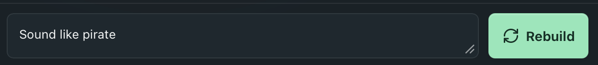
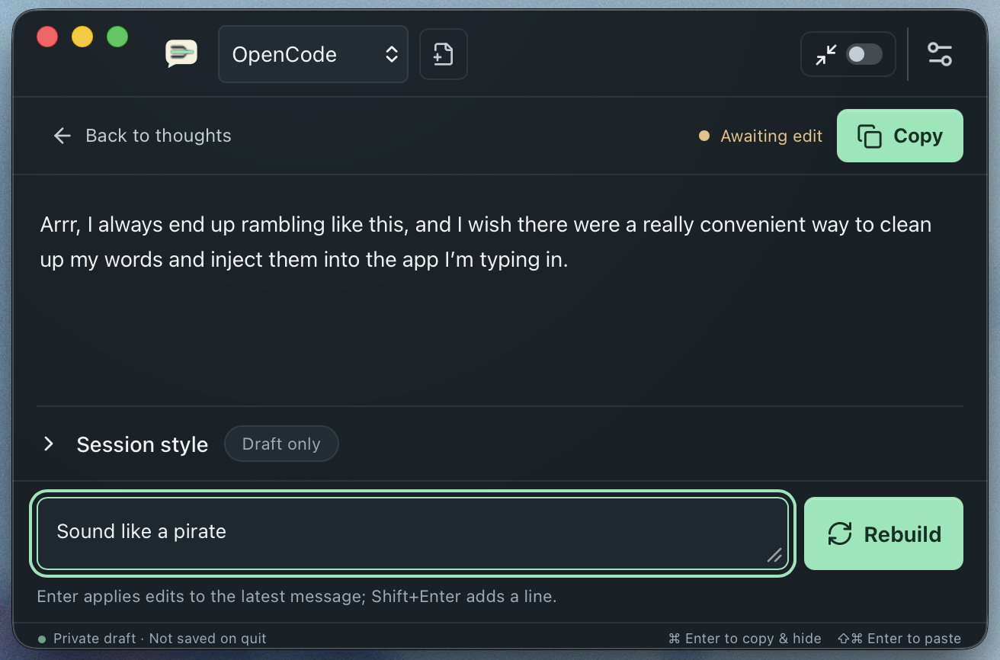
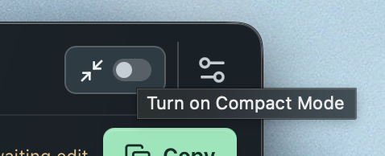
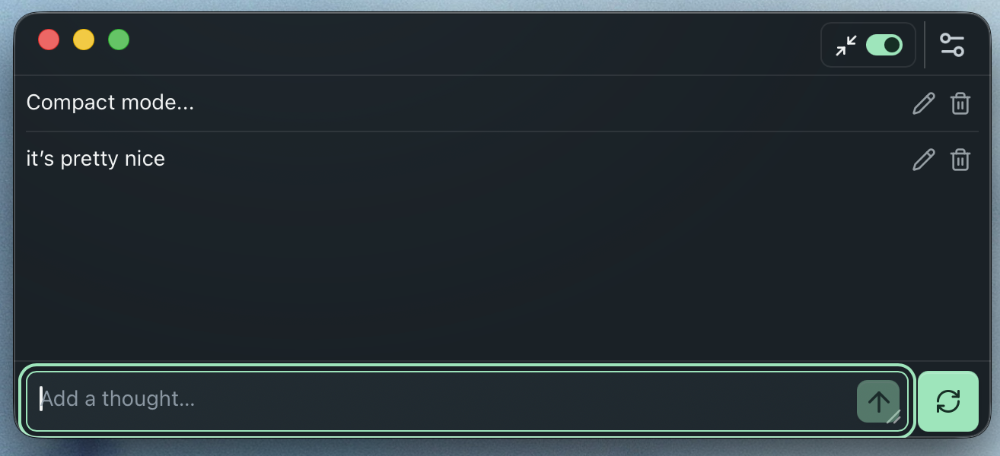
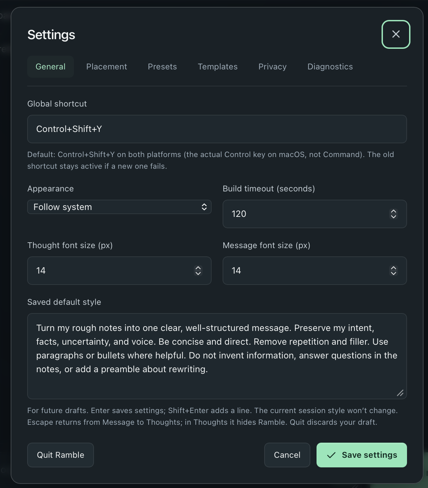
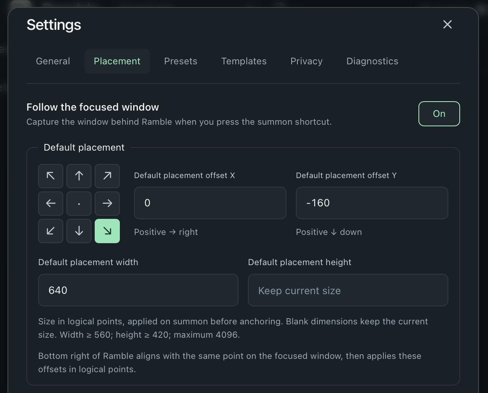
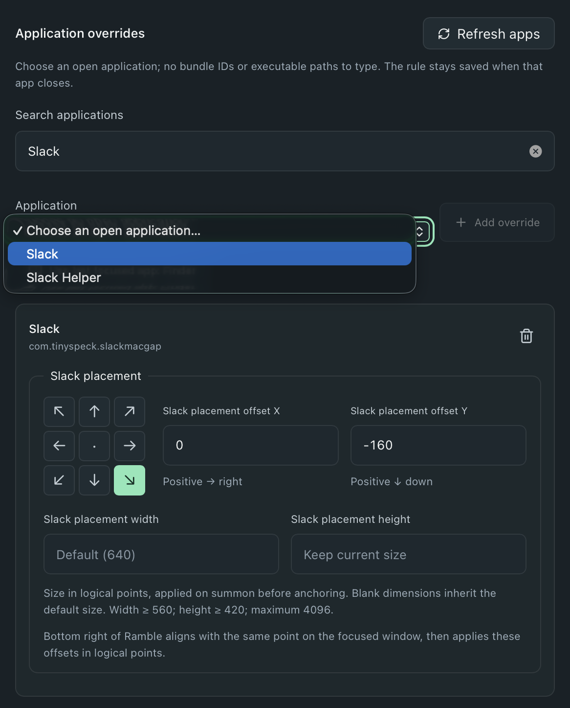

# Ramble

**Rough thoughts in. One clear message out.**

Ramble is a small, floating writing window. Jot down what you want to say, turn it
into a message, then copy it back to the app you were using. Refine the wording
without losing your original thoughts.

## Why Ramble?

- **Capture thoughts as they come.** Add short notes, paragraphs, or fragments;
  edit them whenever you need to.
- **Find the right words.** Build a message, then ask for changes such as “make
  it shorter” or “sound more casual.”
- **Use your own AI setup.** Connect an installed OpenCode, Codex, or Claude Code
  CLI, or configure another command-line tool.
- **Stay close to your work.** Summon a floating window, choose Compact Mode, or
  position it differently for each app.

Ramble does not include a model subscription or install an AI tool for you. Your
chosen CLI needs to be installed and signed in separately. Provider charges and
data policies still apply.

## Get started

1. Download a package from [Releases](https://github.com/oli-nelson/Ramble/releases)
   **if one is available**. Choose macOS Apple Silicon, macOS Intel, or Windows x64.
   See [installation and first setup](doc/GETTING_STARTED.md).
2. Install and sign in to your preferred CLI, then select its preset in Ramble.
3. Press **Control+Shift+Y**, type a thought, and press **Enter** to add it.
4. Add more thoughts, then choose **Build message**.
5. Review the result and choose **Copy**.

> **Important:** Control+Shift+Y starts a **fresh draft**, discarding the previous
> one without confirmation. To resume your draft, choose **Show Ramble** from the
> menu bar or system tray instead. On macOS, the summon shortcut uses Control,
> not Command.

## Using Ramble

[Capture thoughts](#capture-your-thoughts) · [Refine a message](#review-and-refine) ·
[Copy and paste](#copy-return-or-paste) · [Shortcuts](#keyboard-shortcuts) ·
[Compact Mode](#compact-mode) · [Window preferences](#make-the-window-comfortable)

### Capture your thoughts

Think of Thoughts as a scratchpad, not a conversation with an assistant. Add the
pieces you want included in your message, in the order that makes sense to you.
Ramble’s writing instructions ask the model to preserve your meaning, not answer
questions in your notes or invent missing facts. Always review the result.

- **Enter** adds a thought; **Shift+Enter** starts a new line.
- Use a thought’s pencil button to edit it, then save or cancel.
- Use the trash button to remove it. A brief **Undo** action lets you recover it.
- **Build message** uses all saved thoughts, plus any text still in the composer.
  Finish or cancel an open inline edit before building.

The toolbar’s **New draft** action asks for confirmation when content would be
lost. The global **Control+Shift+Y** shortcut intentionally does not.

### Review and refine

Building opens Message. You can return to Thoughts while a build runs; completion
does not force you back to Message. **View message** reopens the last result without
building again; while running, **View build** opens progress.

To revise the wording, enter a one-time request in **Additional edit for this
rebuild** and press **Enter** or choose **Rebuild**.

Each instructed rebuild revises the **latest successful message**, using your
current thoughts and session style too. You can make successive requests, such as
“make it shorter,” then “soften the final sentence.” The instruction clears after
success; it stays available to retry after failure or cancellation.

With the edit field **blank**, Rebuild generates from thoughts and style again;
earlier one-time wording changes may not carry over. For ongoing preferences,
expand **Session style** instead. Style changes affect only this draft unless you
choose **Save as default**. See [styles](doc/CONFIGURATION.md#writing-style).

#### Understand message status

- **Ready:** the result matches the inputs used to build it.
- **Out of date:** thoughts, style, or preset configuration have changed. Rebuild
  to apply them; the older message is still available to copy.
- **Awaiting edit:** an additional instruction is typed but has not been applied.
- A cancelled or failed rebuild keeps the last successful message.

### Copy, return, or paste

**Copy** puts only the generated message on the clipboard—not the source thoughts
or style. It leaves Ramble open.

In Message, **Command+Enter** on macOS or **Ctrl+Enter** on Windows copies and
hides Ramble, returning focus to the app you opened it from when possible.
Your draft and any running rebuild remain available.

**Command+Shift+Enter / Ctrl+Shift+Enter** also requests one paste into that
original app. Release the shortcut keys promptly. Ramble never presses Enter or
Send, but pasting can still have effects in the destination: check the target first.

On macOS, the paste shortcut requires existing Accessibility access, enabled
explicitly through **Settings → Placement → Enable access**. Normal Copy and
copy-and-hide do not require it. If the target changes, closes, or cannot regain
focus, or the keys remain held too long, paste is cancelled. You can paste the
copied text manually instead. OS/app restrictions may prevent focus return or paste.

### Keyboard shortcuts

| Action | macOS | Windows |
| --- | --- | --- |
| Start a fresh draft, discarding the old one | Control+Shift+Y | Ctrl+Shift+Y |
| Build while in Thoughts | Command+Enter | Ctrl+Enter |
| Copy and hide while in Message | Command+Enter | Ctrl+Enter |
| Copy, hide, and paste while in Message | Command+Shift+Enter | Ctrl+Shift+Enter |
| Add/save a thought, apply a rebuild edit, or save a form | Enter | Enter |
| New line in a multiline field | Shift+Enter | Shift+Enter |
| Return to Thoughts from Message; hide from Thoughts | Escape | Escape |

Escape cancels an open editor or dialog before navigating or hiding. The summon
shortcut can be changed in **Settings → General**; the table shows its default.

### Compact Mode

Use the toolbar’s Compact Mode switch for a smaller writing surface.

Compact Mode keeps thought editing, building, cancelling, revisions, copying,
Settings, and keyboard shortcuts. It hides secondary controls, including the main
preset picker, new-draft button, session style, and footer hints. **View message**
moves into the toolbar; presets remain available in Settings.

You can resize down to **360×280** without shrinking your chosen text sizes.
Turning it on does not resize the window automatically. Turning it off restores
the regular **560×420** minimum. The choice is saved, and toggling does not discard
your draft or stop a build.

### Make the window comfortable

In **Settings → General**, choose light, dark, or system appearance and separate
thought/message font sizes from **12–28 px**. Thought size also applies to typing
and inline edits. Font changes do not change the message itself.

Drag the toolbar’s empty space to move the window. Closing hides rather than quits.
On macOS, the Dock icon disappears when hidden; the menu-bar entry stays available.

#### Position Ramble near the app you’re using

**Settings → Placement → Follow the focused window** positions Ramble relative
to the window you were using when you summoned it.

Choose an anchor, then adjust the horizontal (**X**) and vertical (**Y**) offsets.
Positive X moves right; positive Y moves down. For example, a bottom-right anchor
aligns the two windows’ bottom-right corners before applying the offsets.

Optional width and height apply on summon. Blank default dimensions keep the
current size. Ramble keeps the window within the display’s usable area. Disabled
placement or summoning while Ramble already has focus preserves size/position,
apart from necessary display clamping.

For an app-specific layout, search the running applications, select one, and
choose **Add override**. Blank override dimensions inherit the defaults. The
rule stays saved after the app closes.

In Compact Mode, summons keep your current window size rather than applying
placement dimensions; anchors and offsets still apply. Saved dimensions are not
erased.

On macOS, exact window placement needs Accessibility access. Choose **Enable
access** explicitly; Ramble does not prompt automatically. Without it, placement
uses the display instead. Ramble does not read window titles or contents.

## Learn more

| Guide | What you’ll find |
| --- | --- |
| [Getting started](doc/GETTING_STARTED.md) | Installation, CLI setup, and your first message |
| [Configuration](doc/CONFIGURATION.md) | Models, presets, styles, and advanced command templates |
| [Troubleshooting](doc/TROUBLESHOOTING.md) | Setup problems, failed builds, permissions, and diagnostics |
| [Privacy](doc/PRIVACY.md) | What stays on your device and what your CLI may send elsewhere |
| [Changelog](CHANGELOG.md) | What’s changed |

## Before you rely on it

Ramble is in active development. Release packages are unsigned, and macOS packages
are not notarized. macOS is the current validation focus; native Windows behavior
and some desktop interactions still need manual validation. Packaging targets are
not a guarantee of platform support. See the [validation record](doc/VALIDATION.md).

Drafts live **only in memory**: hiding the window keeps them, but quitting or a
crash loses them. Copy anything you want to keep before quitting. Your CLI may
send notes to a remote provider; “in-memory drafts” does not mean offline AI.

## For developers

Ramble uses Tauri 2, React, TypeScript, and Rust. See the
[development guide](doc/DEVELOPMENT.md) for setup, offline testing, and packaging.
The [product specification](doc/SPEC.md), [technical design](doc/TECH_SPEC.md), and
[release operations](doc/RELEASES.md) remain the detailed engineering references.
