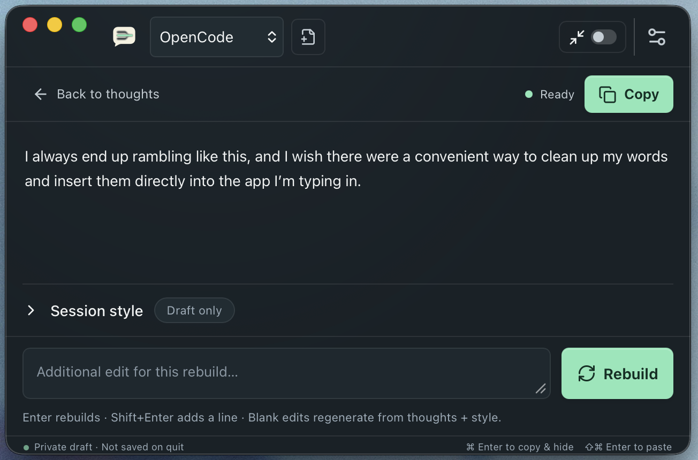
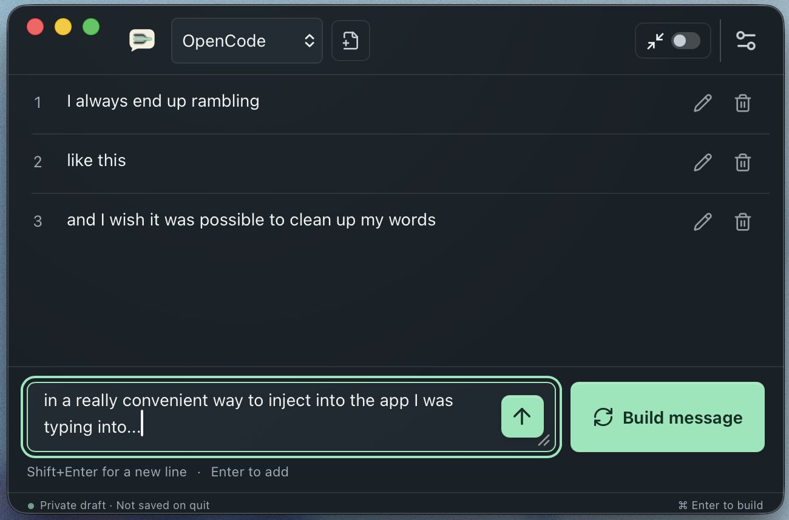

# Ramble

**Rough thoughts in. One clear message out.**

Ramble is a small, floating writing window. Jot down what you want to say, turn it
into a message, then copy it back to the app you were using. Refine the wording
without losing your original thoughts.

## Why Ramble?

- **Capture thoughts as they come.** Add short notes, paragraphs, or fragments;
  edit them whenever you need to.
- **Find the right words.** Build a message, then ask for changes such as “make
  it shorter” or “sound more casual.”
- **Use your own AI setup.** Connect an installed OpenCode, Codex, or Claude Code
  CLI, or configure another command-line tool.
- **Stay close to your work.** Summon a floating window, choose Compact Mode, or
  position it differently for each app.

Ramble does not include a model subscription or install an AI tool for you. Your
chosen CLI needs to be installed and signed in separately. Provider charges and
data policies still apply.

## Get started

1. Download a package from [Releases](https://github.com/oli-nelson/Ramble/releases)
   **if one is available**. Choose macOS Apple Silicon, macOS Intel, or Windows x64.
   See [installation and first setup](doc/GETTING_STARTED.md).
2. Install and sign in to your preferred CLI, then select its preset in Ramble.
3. Press **Control+Shift+Y**, type a thought, and press **Enter** to add it.
4. Add more thoughts, then choose **Build message**.
5. Review the result and choose **Copy**.

> **Important:** Control+Shift+Y starts a **fresh draft**, discarding the previous
> one without confirmation. To resume your draft, choose **Show Ramble** from the
> menu bar or system tray instead. On macOS, the summon shortcut uses Control,
> not Command.

## Learn more

| Guide | What you’ll find |
| --- | --- |
| [Getting started](doc/GETTING_STARTED.md) | Installation, CLI setup, and your first message |
| [Using Ramble](doc/USER_GUIDE.md) | Writing, revisions, shortcuts, Compact Mode, and window placement |
| [Configuration](doc/CONFIGURATION.md) | Models, presets, styles, and advanced command templates |
| [Troubleshooting](doc/TROUBLESHOOTING.md) | Setup problems, failed builds, permissions, and diagnostics |
| [Privacy](doc/PRIVACY.md) | What stays on your device and what your CLI may send elsewhere |
| [Changelog](CHANGELOG.md) | What’s changed |

## Before you rely on it

Ramble is in active development. Release packages are unsigned, and macOS packages
are not notarized. macOS is the current validation focus; native Windows behavior
and some desktop interactions still need manual validation. Packaging targets are
not a guarantee of platform support. See the [validation record](doc/VALIDATION.md).

Drafts live **only in memory**: hiding the window keeps them, but quitting or a
crash loses them. Copy anything you want to keep before quitting. Your CLI may
send notes to a remote provider; “in-memory drafts” does not mean offline AI.

## For developers

Ramble uses Tauri 2, React, TypeScript, and Rust. See the
[development guide](doc/DEVELOPMENT.md) for setup, offline testing, and packaging.
The [product specification](doc/SPEC.md), [technical design](doc/TECH_SPEC.md), and
[release operations](doc/RELEASES.md) remain the detailed engineering references.
