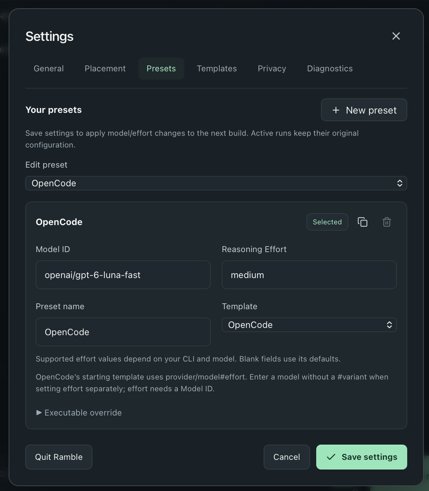
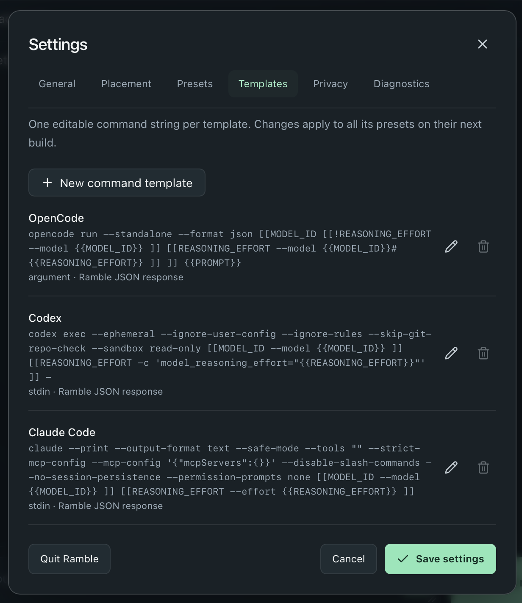

# Configure Ramble

[Back to README](../README.md) · [Troubleshooting](TROUBLESHOOTING.md)

Most users only need to select a preset, choose a supported model, and adjust
their writing style. Command templates are an advanced option.

## Presets: choose your tool and model

A **preset** is a named choice of command template, model, and reasoning effort.
Select one from the main toolbar, or open **Settings → Presets** to edit it.



1. Choose the preset in **Edit preset**.
2. Set **Model ID** and, if supported, **Reasoning Effort**.
3. Choose **Save settings**. If editing an inactive preset, explicitly select it
   for use as well; editing alone does not activate it.

Use **New preset** to create another choice, or the duplicate button to start
from an existing one. In Compact Mode, use Settings to switch presets.

The initial OpenCode preset uses `openai/gpt-6-luna` with `medium` effort; Codex
uses `gpt-6-luna` with `medium` effort. These are starting values, not a promise
that your account or CLI supports them. The screenshots may show customized values.
Blank fields use the CLI’s defaults where the template permits it.

For OpenCode, enter `provider/model` without a `#variant` when setting effort
separately; the starting template combines model and effort for you. Supported
model IDs and effort values depend on your installed tool and provider.

Changes apply to the next build, not an already-running one. Changing the preset
can mark an existing result out of date without removing it.

## Writing style

Set your usual preferences in **Settings → General → Saved default style**.
For example:

> Keep my voice. Be concise and friendly. Use short paragraphs and end with a clear ask.

New drafts start with that saved style. Expand **Session style** under a message
to change it for the current draft only. **Save as default** makes it the starting
style for future drafts; **Reset to saved default** restores the saved preference.
An empty style is allowed; the baseline cleanup instructions still apply.

Use the additional-edit field for a one-time revision, not a lasting style rule.
Neither changing nor saving style automatically rebuilds a message.

## Advanced: command templates

A **command template** defines how Ramble launches an installed CLI. Presets
reuse it with different model/effort choices. Open **Settings → Templates** to
edit a starting template or add your own.



**Only use commands you trust.** They execute with your user permissions and
inherit the app’s environment and normal CLI authentication. They may load CLI
configuration or integrations. Ramble’s template system is not a sandbox, and
starting flags do not guarantee isolation. Authenticate the CLI outside Ramble.

### Command and prompt transport

Enter one command string; the first word is the executable. Quote paths and
arguments containing spaces. For an argument-based CLI, a template might look like:

```text
my-cli [[MODEL_ID --model {{MODEL_ID}} ]] [[REASONING_EFFORT --effort {{REASONING_EFFORT}} ]] {{PROMPT}}
```

This illustrates template syntax, not flags guaranteed to work with a real tool.
Check your installed CLI’s documentation before configuring it.

| Variable | Value |
| --- | --- |
| `{{MODEL_ID}}` | The preset’s model ID |
| `{{REASONING_EFFORT}}` | The preset’s effort value |
| `{{PROMPT}}` | Ramble’s complete writing request |

- Choose **argument** transport and include exactly one `{{PROMPT}}`, or choose
  **stdin** transport and omit that placeholder. Stdin sends the request through
  the process’s standard input instead of its argument list.
- `[[MODEL_ID … ]]` includes a section only when that field is set. The same
  syntax works for `REASONING_EFFORT`; prefix the guard with `!` for the blank case.
- Quotes group arguments; `""` preserves an empty argument. Backslash can escape
  quotes, whitespace, backslashes, and literal opening braces/brackets. Ordinary
  Windows path separators are preserved.
- Ramble parses before substituting values. Injected values stay literal; they
  are not interpreted as new flags, template syntax, or shell commands.
- There is **no shell expansion, piping, or redirection**. Use an executable
  runtime for scripts, such as `node.exe` plus the script path on Windows, rather
  than a `.cmd`/`.bat` wrapper.

Argument-based prompts may be visible in OS process listings. Prefer stdin when
your CLI supports it. Template edits affect all associated presets on their next
build. To inspect an invocation first, use [Diagnostics](TROUBLESHOOTING.md#inspect-an-invocation).

### Required response format

Pass Ramble’s generated prompt unchanged to the model. It asks for a JSON object
with exactly one property containing a nonblank message:

```json
{"ramble_response":"The finished message"}
```

Every template uses this same format—there is no parser to select. Final-text or
print mode is usually the simplest CLI output choice. Ramble can find the object
inside logs, Markdown fences, or JSON envelopes, but rejects missing, invalid, or
conflicting responses. Identical duplicates are accepted. A failed process exit
is always a failed build, even if it printed a response.

The key is a format marker, not proof that text came from the model: matching
JSON echoed from notes or logs can also be recognized. It is not a security boundary.

## Existing settings and upgrades

Ramble preserves supported older settings when upgrading. Customized commands
and explicit model choices stay intact; pristine older built-ins may receive
updated starting commands. Older argument-list templates become command strings,
and obsolete parser choices are removed. **Custom commands must now return the
JSON response above**, not just plain message text.

The original migrated settings file is backed up on the next settings write.
Unreadable or newer, unsupported settings are preserved rather than overwritten;
follow the recovery instructions shown in the app. Settings contain preferences,
not your draft history. See [privacy](PRIVACY.md).
