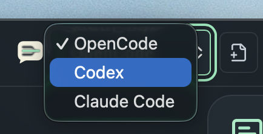
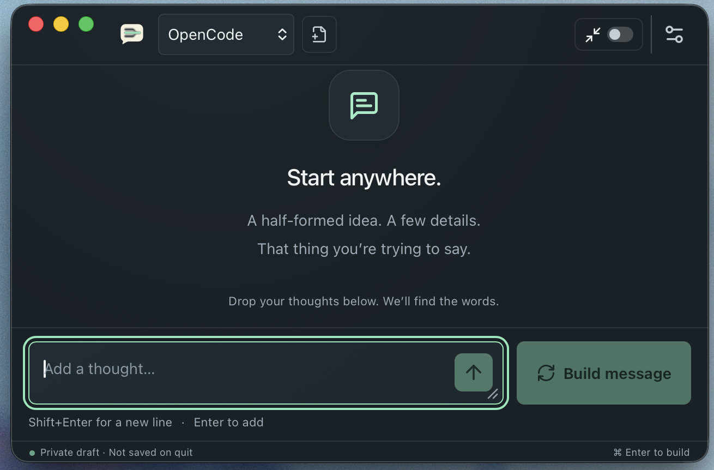

# Getting started with Ramble

[Back to README](../README.md) · [Using Ramble](USER_GUIDE.md)

## 1. Install Ramble

Check the repository’s [Releases page](https://github.com/oli-nelson/Ramble/releases)
for available downloads. If there is no published package, you can
[build from source](DEVELOPMENT.md); there is no separate installer download implied.

| Your computer | Package archive |
| --- | --- |
| Mac with Apple Silicon | `ramble-<version>-macos-arm64.tar.gz` |
| Mac with an Intel processor | `ramble-<version>-macos-x64.tar.gz` |
| Windows x64 PC | `ramble-<version>-windows-x64.tar.gz` |

On a Mac, **Apple menu → About This Mac** identifies your chip or processor.
Extract the archive before installing:

- **macOS:** open the `.dmg` and copy Ramble to Applications.
- **Windows:** run the included `.exe` installer.

Packages are currently **unsigned**, and macOS packages are **not notarized**.
Your operating system may warn or block installation. Only proceed with a package
whose source you trust; see [installation troubleshooting](TROUBLESHOOTING.md#installation-warnings).
Minimum OS support and native Windows validation are not yet finalized.

## 2. Set up an AI command-line tool

Ramble sends your writing request to a command-line tool (CLI) installed on your
computer. It does not supply its own AI account, API key, or subscription.

1. Install **OpenCode**, **Codex**, or **Claude Code** using that tool’s official
   installation instructions.
2. Complete its sign-in/setup in a terminal, outside Ramble.
3. Open Ramble and choose the matching preset from the toolbar.

OpenCode is selected initially. If you need a different model, open
**Settings → Presets**, edit **Model ID** and **Reasoning Effort**, then save.
Use identifiers supported by your CLI and account; Ramble does not verify model
availability online. See [configuration](CONFIGURATION.md).

Your chosen CLI may send your notes to remote services and incur charges. Its
normal authentication, settings, and integrations may apply. Read the
[privacy guide](PRIVACY.md) before using sensitive material.

## 3. Write your first message

Press **Control+Shift+Y** to open a new draft. On macOS this is the actual Control
key, not Command.

1. Type a thought and press **Enter** to add it. Use **Shift+Enter** for a newline.
2. Add any other details the message needs. Fragments are fine.
3. Choose **Build message**. Text still in the input is included too.
4. Review the result. Check facts and wording before using it.
5. Choose **Copy**, then paste into your destination app.

Want a change? Type an instruction such as “shorten the opening” in
**Additional edit for this rebuild**, then choose **Rebuild**.

## 4. Keep or dismiss your draft

- Close the window to hide Ramble without quitting.
- Choose **Show Ramble** from the menu bar/system tray to resume your draft.
- Press **Escape** in Message to return to Thoughts; press it in Thoughts to hide
  Ramble and return focus to the original app.
- Use **Settings → Quit Ramble** to exit. Copy anything important first.

**The summon shortcut always starts over**, even when Ramble is already visible.
It discards the previous draft without confirmation and cancels a running build.
Hiding preserves a draft; quitting or a crash does not.

Next: [revisions, keyboard shortcuts, and Compact Mode](USER_GUIDE.md).
