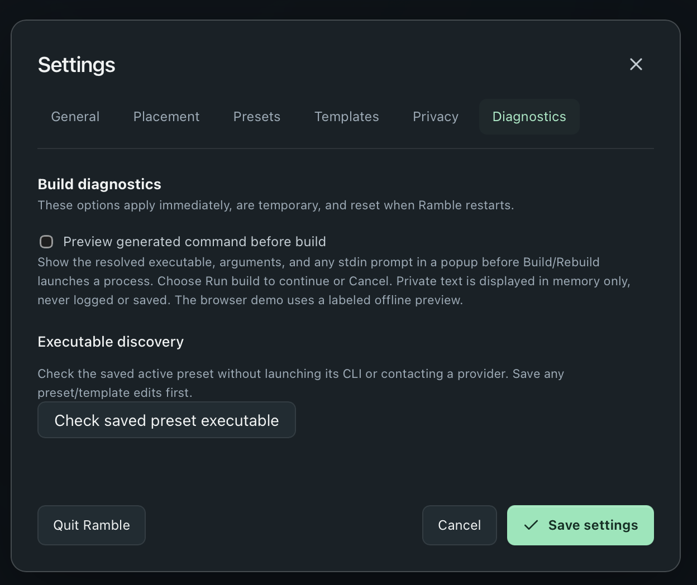

# Troubleshooting

[Back to README](../README.md) · [Configuration](CONFIGURATION.md)

## Installation warnings

Release packages are unsigned; macOS packages are also not notarized. Download
only from a source you trust and verify the release’s SHA-256 checksums if needed.
The release page supplies `SHA256SUMS` for the package archives.

If macOS blocks opening a trusted download, review its **System Settings → Privacy
& Security** message and Apple’s guidance for opening apps from unidentified
developers. On Windows, review the security warning and your organization’s
policy. Do not disable system protections globally to install Ramble. Managed
computers may require administrator approval.

## Ramble is hidden or the shortcut does not work

- Use **Show Ramble** in the macOS menu bar or Windows system tray. This resumes
  the current draft instead of clearing it.
- Check **Settings → General → Global shortcut** for your saved binding. The
  default is Control+Shift+Y; on macOS, use Control rather than Command.
- Choose another binding if another app uses it. If registration fails, Ramble
  shows an error and keeps the old shortcut when possible.
- On macOS, a hidden window also removes Ramble from the Dock. Its menu-bar entry
  remains available.

## My draft disappeared

The summon shortcut starts a fresh draft **without confirmation**. Use the
menu-bar/tray **Show Ramble** action when you want to resume instead.

Drafts are not saved to disk. Hiding preserves them, but quitting, restarting,
or a crash loses them. There is no history browser or draft recovery. Copy
important messages somewhere durable before quitting.

## A build cannot find or start my CLI

1. Confirm the CLI is installed and signed in from a terminal.
2. Confirm the correct preset is selected and its model is supported by your account.
3. In **Settings → Diagnostics**, choose **Check saved preset executable**.
   Save any preset/template changes first. This checks locally without starting
   the CLI or contacting a provider.
4. If necessary, set an absolute path under the preset’s **Executable override**.
   GUI-launched apps may have a different executable search path from your terminal.
5. Check custom flags against your installed CLI version. A sign-in or permission
   prompt that works interactively may not work in a noninteractive Ramble build.

Ramble does not install tools, sign in for you, or verify model availability.

## A build fails, times out, or returns no usable message

- Verify authentication, network access, model ID, and effort with your CLI’s
  documentation. Avoid sharing private prompts while investigating.
- Check **Settings → General → Build timeout** if a working model needs longer.
- For custom commands, ensure the model receives the complete prompt and returns
  the [required JSON response](CONFIGURATION.md#required-response-format).
- Choose **Cancel** to stop a build. A failed or cancelled rebuild keeps the last
  successful message and preserves the additional edit for retry.

If offered **View harness output**, you can inspect captured CLI output to help
diagnose the problem. **It may contain your notes, prompts, or credentials.**
Choose **Not now** to discard it instead. Output is fetched only with your consent,
bounded to 256 KiB per stream, and kept only in memory. It is discarded after
viewing/dismissal, the next build, a new draft, or quit. Do not post it publicly
without reviewing and redacting it.

## Inspect an invocation

Open **Settings → Diagnostics** and enable **Preview generated command before build**.

Your next Build/Rebuild shows the resolved executable, arguments, and any stdin
prompt before launching. **Run build** continues; **Cancel** closes the preview
without consuming your notes or launching the command. This setting is temporary
and resets when Ramble restarts.

Previews contain private text. They are displayed only in memory, not logged or
saved. Terminal replay commands are quoted for zsh/bash on macOS or PowerShell on
Windows; supply displayed stdin separately. Running a replay yourself can transmit
data, incur charges, or have other effects. Ramble’s own builds do not use a shell.

## Placement or paste is not working

- On macOS, exact focused-window placement and the explicit paste shortcut require
  Accessibility access. Use **Settings → Placement → Enable access**, then review
  the OS permission settings. Ramble never requests it automatically.
- Without exact geometry, placement falls back to the display. Check whether
  **Follow the focused window** and the appropriate app override are enabled.
- Compact Mode intentionally ignores placement width/height and keeps the current
  size. Leave Compact Mode to restore placement sizing.
- Copy-and-hide does not paste. Use **Command+Shift+Enter / Ctrl+Shift+Enter** in
  Message for an explicit paste, then release the keys promptly.
- Keep the original destination app open. Switching focus during the return or
  holding the shortcut for too long cancels paste. OS/app restrictions can reject it.
- If paste fails after copying, use normal paste in your destination app. Ramble
  does not retry a potentially delivered paste gesture.

## Settings cannot be saved

Follow the recovery message in Ramble. Unreadable or newer, unsupported settings
are preserved and made read-only rather than silently replaced. Back up the
existing file before making manual changes. Copy your draft before restarting.

## Reporting a problem

Include your Ramble version, operating system/chip, selected CLI and its version,
what you expected, and the steps to reproduce. Note whether you used a release
package or a source build. Redact personal text, paths, tokens, and credentials
from screenshots or diagnostics. Never include private harness output by default.
